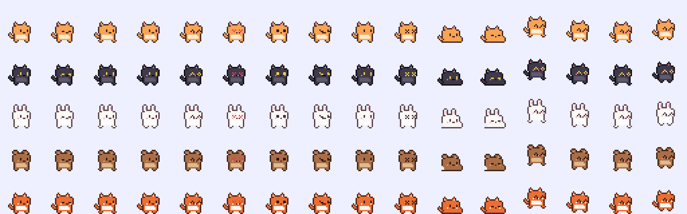

# Temani

Pet pixel kecil yang hidup di pojok layar Mac-mu. Dia jalan-jalan di tepi bawah layar, ketiduran, joget
sendiri, bersin, mengejar kupu-kupu, dan kadang pulang membawa bunga. Ikonnya di menu bar ikut bergerak.

Bikin pet-mu sendiri di web, undang teman, lalu titipkan pet ke Mac masing-masing.



> **Cuma mainan.** Aplikasi Mac-nya tidak membaca layar, ketikan, atau berkas, dan tidak meminta izin
> Aksesibilitas atau Perekaman Layar. Lihat [Keamanan](#keamanan).

## Isi repo

| Bagian | Folder | Teknologi |
|---|---|---|
| Aplikasi Mac (menu bar + pet di desktop) | `Sources/Temani/` | Swift + AppKit, tanpa dependensi |
| Server (API, admin, worker generate) | `server/` | Go + PostgreSQL |
| Web pengguna & ruang admin | `web/` | Vue 3 + Vite |

## Yang bisa dilakukan

**Pet di Mac**

- Berjalan, berlari, rebahan, tidur (lebih sering di malam hari), melompat, joget, melambai.
- Kejutan: bersin, tersandung, mengejar kupu-kupu, main bola, pergi lalu pulang membawa hadiah yang bisa diklik.
- Klik = dielus. Klik dua kali = lompat + lelucon. Seret = diangkat, lepas = jatuh (kalau tinggi, pusing).
- Menu: beri makan, ajak main bola, panggil ke layar tempat kursor berada, sembunyikan dari desktop.
- Pengingat lembut (minum air, regangkan badan) kalau dinyalakan.
- Tanpa akun pun jalan: pilih salah satu dari lima pet bawaan di Pengaturan.

**Akun & web**

- Tiga cara membuat pet: pilih bawaan, gambar di editor piksel (16 pose × 32×32), atau dari foto.
- Dari foto: otomatis lewat AI yang diatur admin (kenari.id / OpenRouter), atau manual — salin prompt +
  contoh tata letak ke ChatGPT, lalu unggah hasilnya. Server memotong, membuang latar, dan merapikannya jadi pixel art.
- Teman: undang lewat tautan atau nama pengguna. Minta pet teman; setelah diizinkan, pet itu ikut tampil di Mac-mu.
- Sapa teman: pet di Mac-nya yang menyampaikan pesanmu.

**Admin** (`/admin`, akun & sesi terpisah dari pengguna)

- Ringkasan, pengguna (nonaktifkan), pet (sembunyikan), riwayat generate, jejak audit, akun admin.
- **Koneksi AI**: tambah / ubah / tes koneksi ke kenari.id, OpenRouter, atau endpoint kompatibel OpenAI;
  ambil daftar model dari provider; atur prioritas cadangan. API key disimpan terenkripsi.
- Pengaturan: buka/tutup pendaftaran, jatah generate harian, batas pet, prompt generate.

## Pasang aplikasi Mac

1. Unduh `Temani.zip` dari [Releases](../../releases/latest), ekstrak, pindahkan `Temani.app` ke **Applications**.
2. Sekali saja (aplikasi belum dinotarisasi Apple):
   ```bash
   xattr -cr /Applications/Temani.app
   ```
   ```bash
   open /Applications/Temani.app
   ```
3. Klik ikon pet di menu bar → **Hubungkan akun…** untuk memakai pet buatanmu. Browser terbuka dengan sebuah
   kode; setujui di sana. Password tidak pernah diketik di aplikasi.

Atau build sendiri:

```bash
./scripts/build.sh
```

```bash
cp -R build/Temani.app /Applications/
```

Syarat: macOS 13 (Ventura) ke atas, Apple Silicon atau Intel.

## Menjalankan server & web

Dengan Docker (lihat [DEPLOY.md](DEPLOY.md) untuk VPS):

```bash
cp .env.example .env
```

```bash
make up
```

```bash
make admin EMAIL=kamu@contoh.id PASSWORD='password-panjang'
```

Lokal tanpa Docker (butuh PostgreSQL):

```bash
make build-web
```

```bash
make dev-server
```

`make dev-server` memakai `AI_MOCK=1`, jadi generate dari foto bisa dicoba tanpa API key. Untuk mengembangkan
web dengan hot reload, jalankan `make dev-web` di terminal lain (port 5173, `/api` diteruskan ke :8080).

Aplikasi Mac bawaan menunjuk ke `https://temani.katili.dev`. Untuk server sendiri: Pengaturan → Akun → Alamat server.

## Cara kerja singkat

```
Sprites.swift (teks → piksel) ──make sprites──► template PNG server + docs/sprites.png

web  ──cookie sesi + CSRF──►  /api/…          pengguna
web  ──cookie admin + CSRF──► /api/admin/…    admin (tabel, sesi, cookie sendiri)
Mac  ──token perangkat─────►  /api/app/…      daftar pet yang tampil di Mac + sapaan

foto ─► provider AI (koneksi admin) ─► gambar grid 4×4 ─► sprite.Normalize ─► sheet 128×128 ─► pet
```

Format pet di semua tempat: PNG 128×128, grid 4×4, tiap pose 32×32, menghadap kanan. Urutan pose:
diam, kedip, jalan 1, jalan 2, senang, sayang, kaget, sedih, makan, pusing, rebahan, tidur, lompat,
melambai, joget 1, joget 2.

## Keamanan

- Aplikasi Mac hanya: menggambar sprite di jendela transparan, membaca **posisi** kursor, dan (bila akun
  terhubung) mengambil gambar pet + sapaan teman dari server. Tidak ada izin sistem yang diminta.
- Token perangkat disimpan di Keychain, hanya berlaku untuk `/api/app/*`, dan bisa dicabut dari web (halaman Mac).
- Foto untuk generate dihapus dari server begitu prosesnya selesai.
- Password di-hash argon2id. Sesi admin terpisah, `SameSite=Strict`, maksimal 12 jam, semua tindakannya dicatat.
- API key provider AI dienkripsi AES-256-GCM dengan `APP_SECRET` dan tidak pernah dikirim balik ke browser.

## Rilis & CI

| Workflow | Kapan | Apa |
|---|---|---|
| `mac.yml` | push yang menyentuh `Sources/`, `Resources/` | build universal di macOS, uji jalan; di `main` dengan versi baru → tag `v<versi>` + Release |
| `ci.yml` | push / PR yang menyentuh `server/`, `web/` | gofmt, vet, test + PostgreSQL, cek template sinkron, build web, build image |
| `deploy.yml` | push ke `main` | CI lalu deploy SSH ke VPS (hanya kalau variable `DEPLOY_ENABLED=true`) |

Merilis aplikasi Mac: naikkan `VERSION` dan `Resources/Info.plist` (aturan di [AGENTS.md](AGENTS.md)), merge ke `main`.

## Uninstall

Ikon pet → **Pengaturan… → Tentang → Uninstall…**. Manual:

```bash
pkill -x Temani
```

```bash
defaults delete id.local.temani
```

```bash
security delete-generic-password -s id.local.temani -a device-token
```

Lalu seret `Temani.app` ke Tong Sampah.
